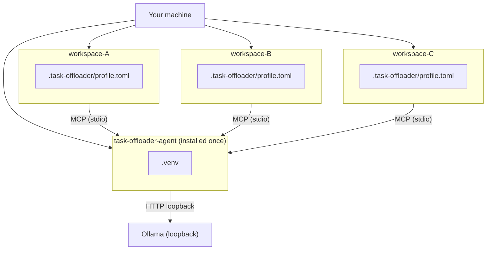

# TaskOffloaderAgent

A **local-model MCP service** for primary AI coding agents (Copilot, Claude, Gemini, Cursor). Offloads bounded, file-heavy subtasks — log triage, code Q&A — to a local [Ollama](https://ollama.com) model. The primary agent keeps the plan; this agent returns structured findings.

> No workspace data leaves the machine. All reads are path-guarded, secrets redacted, results audited.

---

## How it fits together



---

## Quick start

**Requirements:** Python >= 3.12, [Ollama](https://ollama.com) running, at least one model pulled.

### 1 — Pull a model

```bash
ollama pull qwen2.5-coder:7b    # or any model from ollama list
```

### 2 — Install

```bash
cd task-offloader-agent
python -m venv .venv

# Windows
.venv\Scripts\activate
# macOS / Linux
source .venv/bin/activate

pip install -e .
task-offloader --version
```

### 3 — Create workspace config

```bash
# Windows
mkdir <your-workspace>\.task-offloader
copy assets\workspace\profile.toml <your-workspace>\.task-offloader\

# macOS / Linux
mkdir -p <your-workspace>/.task-offloader
cp assets/workspace/profile.toml <your-workspace>/.task-offloader/
```

### 4 — Edit profile

Open `<workspace>/.task-offloader/profile.toml` and set:

```toml
[inference]
model   = "qwen2.5-coder:7b"   # any tag from ollama list
num_ctx = 16384
```

### 5 — Wire to your AI client

See [docs/setup.md -> Step 5](docs/setup.md#step-5--wire-to-your-ai-client) for Copilot, Claude, Cursor, and Antigravity.

---

## On / Off

```bash
task-offloader --workspace <ws> --profile <ws>/.task-offloader/profile.toml off     # pause
task-offloader --workspace <ws> --profile <ws>/.task-offloader/profile.toml on      # resume
task-offloader --workspace <ws> --profile <ws>/.task-offloader/profile.toml status  # state
```

See [Configuration -> Operating modes](docs/configuration.md#operating-modes) for per-tool control.

---

## Tests

```bash
python -m pytest -p no:cacheprovider          # all tests
python -m pytest tests/unit/
python -m pytest tests/security/
python -m pytest tests/integration/           # requires Ollama + model running
```

---

## Docs

| Document | Description |
|---|---|
| [Setup Guide](docs/setup.md) | Install, per-client MCP wiring, multi-workspace |
| [Workspace Config](docs/workspace-config.md) | `.task-offloader/` layout, `profile.toml`, `switch.json` |
| [Configuration Reference](docs/configuration.md) | CLI flags, env vars, profile keys, result contract |
| [Architecture](docs/architecture.md) | Layer diagram, call path, token budget |
| [Security Model](docs/security.md) | Path guard, redaction, audit |
| [Model Guide](docs/models.md) | Comparison table, hardware, multi-model setup |
| [Integration Guide](docs/integration.md) | Writing rules/skills that wire the primary agent |
| [Tools Writer Guide](docs/tools-writer-guide.md) | Adding new MCP tools |

---

MIT — see [LICENSE](LICENSE).