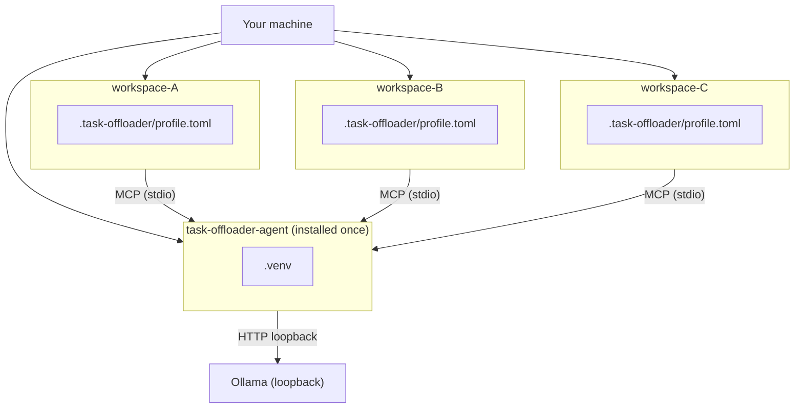

# TaskOffloaderAgent

A **local-model MCP service** for primary AI coding agents (Copilot, Claude, Gemini, Cursor). Offloads bounded, file-heavy subtasks — log triage, code Q&A — to a local [Ollama](https://ollama.com) model. The primary agent keeps the plan; this agent returns structured findings.

> No workspace data leaves the machine. All reads are path-guarded, secrets redacted, results audited.

---

## How it fits together



---

## Quick start

**Requirements:** Python >= 3.12, Git, [Ollama](https://ollama.com/download) installed.

### 1 — Clone

```powershell
# Windows
git clone https://github.com/ashok-murugan/developer-draft.git "%USERPROFILE%\developer-draft"
cd "%USERPROFILE%\developer-draft\task-offloader-agent"
```

```bash
# macOS / Linux
git clone https://github.com/ashok-murugan/developer-draft.git ~/developer-draft
cd ~/developer-draft/task-offloader-agent
```

### 2 — Pull a model

```bash
ollama pull qwen2.5-coder:7b
```

→ Not sure which model? See the [Model Recommendation Guide](docs/models.md).

### 3 — Install

```powershell
# Windows
python -m venv .venv && .venv\Scripts\activate && pip install -e .
task-offloader --version
```

```bash
# macOS / Linux
python -m venv .venv && source .venv/bin/activate && pip install -e .
task-offloader --version
```

### 4 — Initialise a workspace

```bash
cd <your-workspace>
task-offloader init
```

Detects your AI clients, writes `.task-offloader/profile.toml`, and wires the MCP server.  
→ Full walkthrough, flags, and OS-specific paths: [Setup Guide](docs/setup.md).

### 5 — Validate

```bash
task-offloader profile check
```

Restart your AI client. You're done.

---

## On / Off

```bash
task-offloader on      # resume (uses .task-offloader/ defaults)
task-offloader off     # pause
task-offloader status  # state, provider health, token counter
```

> [!NOTE]
> Without `--workspace` and `--profile` flags, the CLI reads `TASK_OFFLOADER_WORKSPACE` and `TASK_OFFLOADER_PROFILE` env vars, or uses the `.task-offloader/task-offloader.ps1` wrapper created by `init`.

See [Configuration → Operating modes](docs/configuration.md#operating-modes) for per-tool control.

---

## Tests

```bash
python -m pytest -p no:cacheprovider          # all tests
python -m pytest tests/unit/
python -m pytest tests/security/
python -m pytest tests/integration/           # requires Ollama + model running
```

---

## Docs

| Document | Description |
|---|---|
| [Setup Guide](docs/setup.md) | Install, `init` command, multi-workspace |
| [Workspace Config](docs/workspace-config.md) | `.task-offloader/` layout, `profile.toml`, `switch.json` |
| [Configuration Reference](docs/configuration.md) | CLI flags, env vars, profile keys, result contract |
| [Architecture](docs/architecture.md) | Layer diagram, call path, token budget |
| [Security Model](docs/security.md) | Path guard, redaction, audit |
| [Model Guide](docs/models.md) | Comparison table, hardware, multi-model setup |
| [Integration Guide](docs/integration.md) | Writing rules/skills that wire the primary agent |
| [Tools Writer Guide](docs/tools-writer-guide.md) | Adding new MCP tools |

---

MIT — see [LICENSE](LICENSE).
