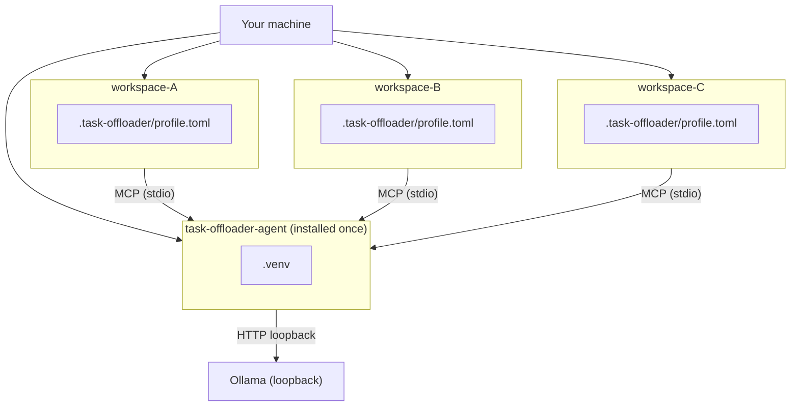

# TaskOffloaderAgent

A **local-model MCP service** for primary AI coding agents (Copilot, Claude, Gemini, Cursor). Offloads bounded, file-heavy subtasks — log triage, code Q&A — to a local [Ollama](https://ollama.com) model. The primary agent keeps the plan; this agent returns structured findings.

> No workspace data leaves the machine. All reads are path-guarded, secrets redacted, results audited.

---

## How it fits together



---

## Quick start

**Requirements:** Python >= 3.12, [Ollama](https://ollama.com) running, at least one model pulled.

### 1 — Pull a model

```bash
ollama pull qwen2.5-coder:7b    # or any model from ollama list
```

### 2 — Install

```bash
cd task-offloader-agent
python -m venv .venv

# Windows
.venv\Scripts\activate
# macOS / Linux
source .venv/bin/activate

pip install -e .
task-offloader --version
```

### 3 — Initialise a workspace

Run from inside your project directory:

```bash
cd <your-workspace>
task-offloader init
```

The command:
- creates `.task-offloader/` with `profile.toml` pre-filled with your model
- detects which AI clients exist (VS Code, Cursor, Claude, Antigravity) and wires the MCP server
- prints a checklist of what was created or skipped

**Options:**

```bash
task-offloader init --model qwen2.5-coder:7b   # skip model prompt
task-offloader init --client 1 3               # wire only Copilot + Cursor (numbered menu)
task-offloader init --force                    # overwrite existing client configs
task-offloader init --dry-run                  # preview without writing
```

Client numbers: `1` VS Code/Copilot · `2` Claude Desktop · `3` Cursor · `4` Antigravity · `5` All.

### 4 — Validate

```bash
task-offloader profile check
```

Fix any reported errors, then restart your AI client.

---

## On / Off

```bash
task-offloader on      # resume (uses .task-offloader/ defaults)
task-offloader off     # pause
task-offloader status  # state, provider health, token counter
```

> [!NOTE]
> Without `--workspace` and `--profile` flags, the CLI reads `TASK_OFFLOADER_WORKSPACE` and `TASK_OFFLOADER_PROFILE` env vars, or uses the `.task-offloader/task-offloader.ps1` wrapper created by `init`.

See [Configuration → Operating modes](docs/configuration.md#operating-modes) for per-tool control.

---

## Tests

```bash
python -m pytest -p no:cacheprovider          # all tests
python -m pytest tests/unit/
python -m pytest tests/security/
python -m pytest tests/integration/           # requires Ollama + model running
```

---

## Docs

| Document | Description |
|---|---|
| [Setup Guide](docs/setup.md) | Install, `init` command, multi-workspace |
| [Workspace Config](docs/workspace-config.md) | `.task-offloader/` layout, `profile.toml`, `switch.json` |
| [Configuration Reference](docs/configuration.md) | CLI flags, env vars, profile keys, result contract |
| [Architecture](docs/architecture.md) | Layer diagram, call path, token budget |
| [Security Model](docs/security.md) | Path guard, redaction, audit |
| [Model Guide](docs/models.md) | Comparison table, hardware, multi-model setup |
| [Integration Guide](docs/integration.md) | Writing rules/skills that wire the primary agent |
| [Tools Writer Guide](docs/tools-writer-guide.md) | Adding new MCP tools |

---

MIT — see [LICENSE](LICENSE).
