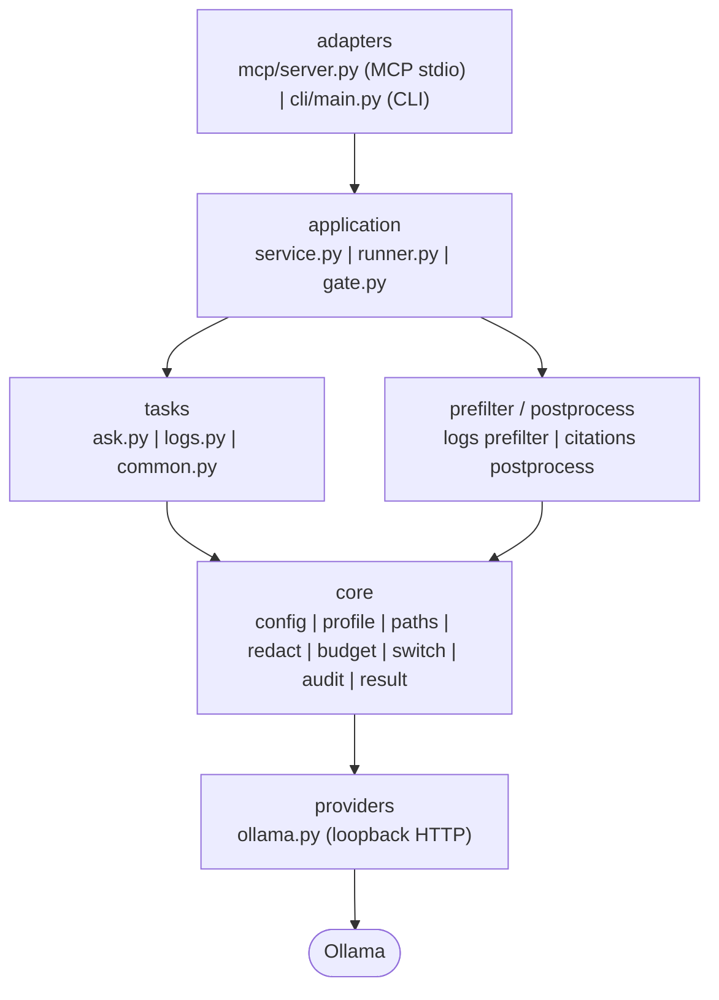

# Architecture

TaskOffloaderAgent is a read-only, loopback-only, local-model service. The primary agent owns all plans, edits, and final answers; this service returns structured findings only.

## Layers



Layers depend downward only. `core` knows nothing about MCP, the CLI, or any specific model server.

## Call path

```
MCP client
  ↓ stdio
adapters.mcp.server         — deserialise, serialise
  ↓
application.runner.run_tool — switch check → deadline → audit
  ↓
tasks/<tool>.run            — prefilter → model → postprocess
  ↓
tasks.common.call_model     — acquire gate → providers.ollama.chat
  ↓
Ollama HTTP (loopback)
```

Audit failure is **fail-open**: result carries a warning instead of blocking the call.

## Token budget

```
input_limit = num_ctx - num_predict - 1500   (headroom for prompt wrapper)
```

| Stage | `num_predict` |
|---|---|
| `local_ask` — chunk pass | 768 |
| `local_ask` — merge pass (multi-chunk) | 1024 |
| `summarize_logs` — narrative | 768 |

`local_ask` splits input into chunks of `chunk_tokens` (default: `min(12000, num_ctx - 2000)`) with at most `max_chunks` (default 4) chunks. Input exceeding the budget is **refused** — never silently truncated. The log digest is capped at 8 000 tokens. Without a tokenizer file, token count uses a conservative 3 chars/token estimate.

## Switch model

1. A tool flag set to `false` wins over everything — the tool is always off.
2. Mode `off` blocks all tools except `local_status`.
3. Mode `manual` allows a call only when `requested_by_user = true`.
4. An unreadable or invalid switch file defaults to `off`.
5. Without a switch file, mode comes from `--mode` / `TASK_OFFLOADER_MODE`, defaulting to `auto`.

## Citation verification

After the model returns, `postprocess.citations` checks every `path:Lx-Ly` reference against the lines actually sent to the model. Unverifiable citations are removed and reported in `checks.citations_removed` and `warnings` — the primary agent is never shown citations it was not given.

## Concurrency

One model call runs at a time via a FIFO gate. Additional calls queue up to `max_pending` (default 3); calls beyond that receive an immediate `busy` error. Client disconnect frees the slot immediately.

## Workspace isolation

The profile must be a file inside the workspace directory. `lifecycle.py` resolves all configured paths at startup and rejects any that escape the workspace boundary.